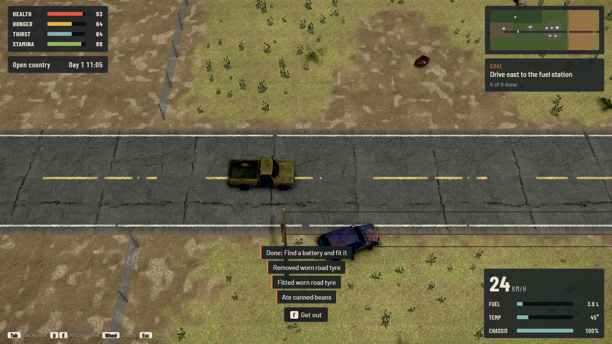
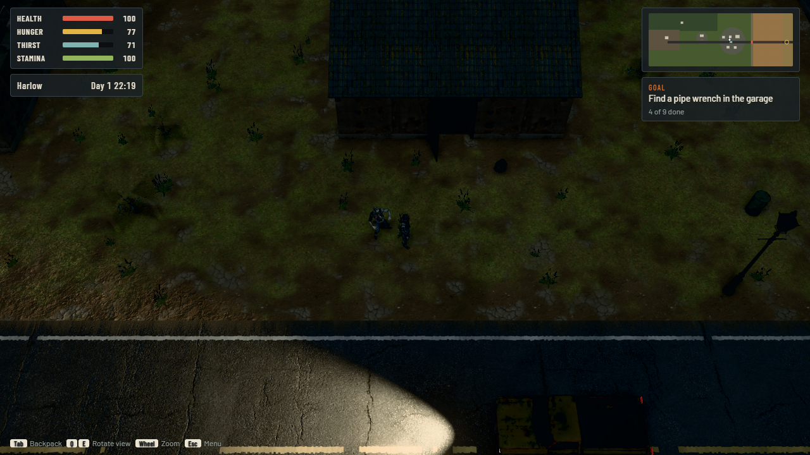

# Rustbound

A top-down 3D survival game where the truck is the progression. You start in a scrapyard with a pickup that will not start. Scavenge parts, fix it, upgrade it, and drive east to Ridge Outpost.

This is the **first playable build** (vertical slice). It runs in a browser with no install.



## Play

**Play in your browser: https://sidxcodes.github.io/rustbound/** (about 30 MB to load the first time).

The whole game is one HTML file, published on the `gh-pages` branch. To play offline, download that `index.html` and open it in
Chrome, Edge or Firefox: no server, no install. Building it yourself (`npm run build`) writes it to `dist/index.html`.

Needs a keyboard and mouse. Touch controls are not in yet.

| Key | Action |
| --- | --- |
| W A S D | Walk. In the truck: drive, brake/reverse, steer |
| Shift | Run (uses stamina) |
| E | Search containers, use the fuel pump, open the truck panel |
| F | Get in or out of the truck |
| Left click / Space | Attack on foot (aims at the mouse). Space is the handbrake when driving |
| Tab | Backpack and crafting |
| Q, E / mouse wheel | Rotate and zoom the camera |
| C | Chase camera while driving |
| Esc | Menu: save, load, sound |

## What works in this build

Everything below is implemented and covered by the automated playthrough test.

- **Truck parts.** 11 slots (engine, battery, radiator, fuel tank, four wheels, bumper, headlights, roof rack). Each part has its own condition. Fit, remove and repair parts in the truck panel. You need the pipe wrench.
- **Parts change how it drives.** Engine condition sets power and top speed. Tyre type and wear set grip. Worn road tyres lose grip and speed off the road. No radiator means the engine overheats, loses condition and cuts out. A bull bar lets you ram the barricade and halves front crash damage. A roof rack adds trunk space.
- **Driving physics.** Rigid body with a two-axle tyre model: understeer at speed, handbrake slides, collisions with impulse and spin, chassis damage from crashes.
- **Fuel.** Fuel cans, a tank you fill by hand, and a station pump with a limited reserve.
- **Survival.** Health, hunger, thirst, stamina. Carry-weight limit. Food, water, bandages.
- **Looting and crafting.** 23 containers with hand-placed key items plus random filler. 4 recipes.
- **Enemies.** 16 husks that wander, chase, attack you or the truck, walk around obstacles, and can be run over.
- **World.** One handcrafted map, about 520 m long: scrapyard, pine forest, fuel station, the town of Harlow, the Dead Stretch (toxic on foot) and Ridge Outpost. Day and night with headlights.
- **Goals.** 9 goals that check real game state, so you can do things in any order.
- **Save and load.** Autosave every 30 s plus manual save in the menu (browser storage).

## Graphics

The look aims at gritty, realistic survival games seen from above: worn photo surfaces, muted olive, brown and grey, soft shadows.
Only free assets are used, all listed with author and licence in `src/assets/LICENSE.md`.

Before (left) and after (right), same spots and times: [scrapyard, forest, fuel station](docs/before-after-1.jpg), [town by day and night, Dead Stretch](docs/before-after-2.jpg).



- **Photo surfaces (PBR).** Ground, road, concrete, walls, roofs, floors, wood and painted metal use photo-scanned textures from
  [Poly Haven](https://polyhaven.com) (CC0) with colour, normal and roughness maps. The ground still blends grass, dirt, cracked earth
  and sand by region, exactly as before; the road has worn paint lines on photo asphalt; big surfaces hide their tiling.
- **Scanned props.** Crates, oil drums, tyres, shelves, toolboxes, jerry cans, an iron bed, table, sofa, jersey barriers, hydrant,
  street lamps, stumps and boulders are Poly Haven models, simplified and compressed. Shipping containers, pallets, pipes, the water
  tower, buildings and the fuel station are built in code but wear the photo textures.
- **Trees, bushes and grass** are photo-scanned plants with millions of leaves, too heavy to draw directly. `tools/bake-impostors.mjs`
  renders each one from the side and from above and the game draws them as a few textured cards (an *impostor*), in instanced
  chunks so off-screen ones are skipped. The swaying grass uses a baked grass clump.
- **Light.** A photographed sky (Poly Haven HDRI) gives reflections and soft sky light by day; a cool moon and dim blue fill at night,
  headlights, brake lights and station lamps. Neutral tone mapping keeps colours natural and a little muted.
- **High** adds ambient occlusion, bloom, colour grading (desaturated, olive mid-tones, cool shadows, greyer at night) and a vignette,
  sky reflections, normal maps, tree shadows and a 2048 px shadow map. **Low** skips all of those, uses half-size textures, a
  1024 px shadow map over a smaller area and fewer grass clumps. The game switches to Low by itself if the frame rate is poor;
  change it any time in the Esc menu.

### Fallbacks

Every layer falls back if it fails to load: photo textures to the textures painted in code, Poly Haven models to the Quaternius
models, Quaternius models to the shapes built in code, the sky light to a plain hemisphere light. `NO_ASSETS=1 npm run build`
builds the game without any of the new assets to check this (it passes all 45 checks).

### Characters and truck

- **Characters** are Mixamo characters with Mixamo animations: the survivor is *Swat Guy* (idle, walk, run, punch, melee swing,
  hit, death), husks are *Yaku J Ignite* and the faster dust husks *Warzombie F Pedroso* (zombie idle, walk, run, attack, hit,
  death). The game picks walk or run by how fast the body really moves and stretches the cycle to match, so feet do not slide.
  The survivor holds the scanned baseball bat (with nails) or pipe wrench in the right hand.
- **The truck** is a rusty pickup from Sketchfab (CC BY 4.0). Its four wheels are separate: each can be removed (cinder blocks
  then hold the axle), the front pair steers and all of them roll; off-road tyres are chunkier. Headlights and brake lights light
  up, and a welded steel bull bar replaces the bumper when fitted. The roof rack sits on the cab.
- **Wrecks** are four Sketchfab wrecks (crashed truck, crashed car, sedan, burnt-out cars), each sized to its old collider.
- Mixamo allows its files inside games but not as standalone files, so the Mixamo downloads and converted `.glb` files are not
  in git: `npm run assets` rebuilds them from `assets-src/` (see `assets-src/DOWNLOADS.md`). Without them the game falls back to
  the Quaternius characters.

## Not in yet (planned)

Shelter building, weather, more vehicles, ranged weapons, a bigger map, touch controls and audio files. See `docs/GDD.md` for the roadmap.

## Develop

```
npm install
npm run build     # bundles src/ and every converted asset into dist/index.html (fails if it passes 60 MB)
npm test          # builds, then plays the whole game in headless Chromium and checks 45 things
npm run assets    # downloads the Poly Haven assets and rebuilds every converted file in src/assets
npm run shots     # screenshots of every region by day and night, plus frame times on High and Low
```

The test needs Playwright's Chromium once: `npx playwright install chromium`. `tests/shots.mjs` takes `soft` (no GPU),
`igpu` or `dgpu` as its second argument; the GPU modes drive Microsoft Edge, because Playwright's headless Chromium has
no GPU. `tools/bake-impostors.mjs` also uses Edge for GPU rendering.

Downloaded source files go in `assets-src/` (not in git). Converted files go in `src/assets/` and are embedded by the build.

Frame rate at 1280 x 720 (frame time including GPU work, so not capped by the display):

| GPU | High | Low |
| --- | --- | --- |
| NVIDIA RTX 3050 Laptop | 125 to 204 fps | 281 to 503 fps |
| Intel UHD (integrated) | 14 to 17 fps (the game drops to Low by itself) | 46 to 83 fps |

## Project layout

```
src/
  main.js              entry point
  page.html            page markup and styles
  core/                Game loop, input, helpers
  data/                items.js (items, parts, recipes, loot), layout.js (the map)
  models/              models.js (buildings, furniture and fallback shapes) and textures.js (painted fallback textures)
  models/pack.js       loads the Quaternius models and builds characters, truck and wrecks from them
  models/props.js      loads the Poly Haven props and baked plants; instancing in culled chunks
  assets/              converted assets: tex/ (photo textures), props/ (models and baked plants), env/ (sky),
                       *.glb (Quaternius pack), manifest.js (generated by the build), LICENSE.md (every credit)
  gfx/                 pbr.js (photo surface materials, Low texture sizes), textures.js (ground noise, road paint),
                       particles, screen effects
  systems/             one file per system: Vehicle, Player, Enemies, Survival, Inventory,
                       Crafting, Interaction, Objectives, World, Environment, CameraRig,
                       Physics, SaveLoad, Audio
  ui/UI.js             HUD, backpack, loot, truck panel, menus, minimap
tests/playthrough.mjs  automated playthrough
tests/shots.mjs        region screenshots and frame times
tools/                 asset scripts: fetch-polyhaven, convert-textures, convert-models, bake-impostors,
                       convert-env, write-licenses, convert-pack (Quaternius); assets.config.mjs lists every asset
assets-src/            downloaded originals (not in git); DOWNLOADS.md lists the ones that need an account
docs/GDD.md            game design document
build.mjs              esbuild bundling script
```

To add an item, part or recipe, edit `src/data/items.js`. To move or add buildings, containers and enemies, edit `src/data/layout.js`. No system code needs to change.

## Credits

- Textures, props, plants and sky: [Poly Haven](https://polyhaven.com), CC0. Authors are listed per asset in `src/assets/LICENSE.md`.
- Characters and animations: [Mixamo](https://www.mixamo.com) (Adobe), royalty-free in games; not redistributed on their own.
- Truck and wrecks: Rashad Ibrahimli and Renafox on [Sketchfab](https://sketchfab.com), CC BY 4.0 (links in `src/assets/LICENSE.md`).
- Fallback models and a few street props: Zombie Apocalypse Kit by [Quaternius](https://quaternius.com), CC0.

The full list (name, author, source, licence) is `src/assets/LICENSE.md`, and the build copies it into `dist/index.html` as a comment.

## Tech

Three.js for rendering. Physics, tyre model, AI and UI are written for this project. Outside assets are CC0 (Poly Haven,
Quaternius), CC BY 4.0 (Sketchfab, credited in `src/assets/LICENSE.md` and inside the built page) or Mixamo (Adobe's terms:
fine inside the game, so the raw and converted Mixamo files stay out of git).
